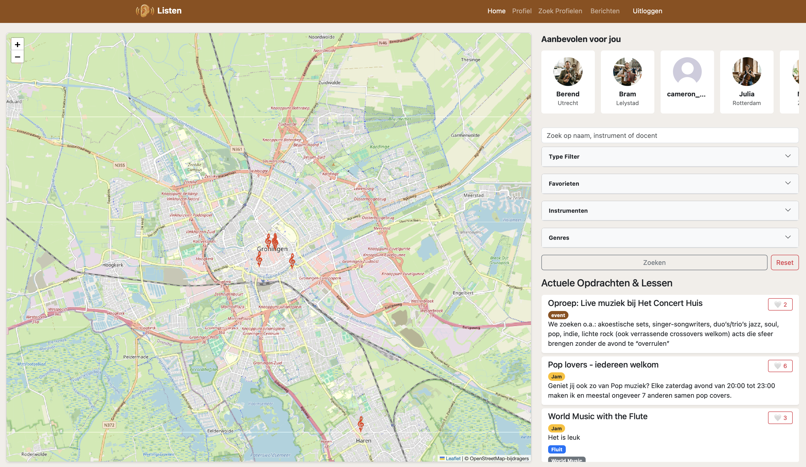
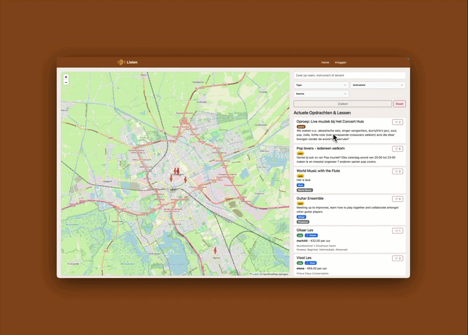

# Hexit (Listen) 🎵


**Hexit** (also known as *Listen*) is a comprehensive platform designed to connect **Musicians**, **Teachers (Docenten)**, and **Music Companies**. Built as part of the Software Engineering II (Software Startup) curriculum, it provides a centralized hub for the music community to network, organize jam sessions, schedule lessons, and share their musical portfolios.

## 🎥 Project Demo





## 🚀 Key Features

- **Role-Based Profiles**: Dedicated profiles for Musicians, Teachers, and Companies.
- **Media Portfolios**: Users can upload and showcase their talent through audio files, videos, and YouTube links.
- **Event Management**: Create, browse, and participate in music-related events such as **Jam Sessions** and **Lessons**.
- **Interactive Community**:
  - Like and save events.
  - Direct messaging system between users to facilitate collaboration.
  - Instrument tracking and matching for musicians.
- **Search Capabilities**: Find other musicians, teachers, or events based on specific criteria.
- **Admin Dashboard**: Centralized management for platform administrators.

## 🛠️ Tech Stack

- **Backend**: Java 21, Spring Boot, Spring Data JPA, Spring Web MVC
- **Frontend**: Thymeleaf (Server-Side Templating), HTML/CSS
- **Database**: MySQL 8.0
- **Containerization**: Docker & Docker Compose
- **Build Tool**: Maven

## 🐳 Running the Application (Docker)

### Prerequisites
- [Docker](https://www.docker.com/get-started) and [Docker Compose](https://docs.docker.com/compose/install/) installed on your machine.

### Quick Start
1. **Clone the repository** (if you haven't already):
   ```bash
   git clone https://github.com/coolstavo/Haxit-BV.git
   cd Listen
   ```
2. **Start the containers**:
   ```bash
   docker compose up -d --build
   ```
   *This will build the Spring Boot application and start the MySQL database, the Adminer GUI, and the web application.*
3. **Access the Application**:
   - **Web App**: http://localhost:8080
   - **Database GUI (Adminer)**: http://localhost:8081 (credentials are in `docker-compose.yml`)
4. **Stop the containers**:
   ```bash
   docker compose down
   ```

## 📁 Project Structure

- `src/main/java/com/webapp/hexit/`: Core Java source code (Controllers, Models, Services, Repositories).
- `src/main/resources/templates/`: Thymeleaf HTML templates (e.g., `jam.html`, `lesson.html`, `profile-muzikant.html`).
- `docker-compose.yml`: Orchestrates the Spring Boot app, MySQL database, and Adminer.
- `Dockerfile`: Multi-stage build for compiling and packaging the Java application.

## 🎓 About This Project

Developed during the 4th year of the **Bachelor HBO-ICT, Software Engineering** program for the **Software Engineering II: Software Startup** course. Demonstrates proficiency in full-stack Java development, relational database design, and modern containerized deployment practices.
